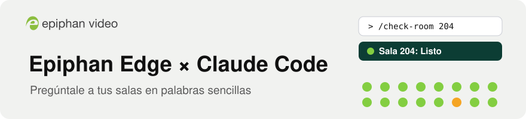
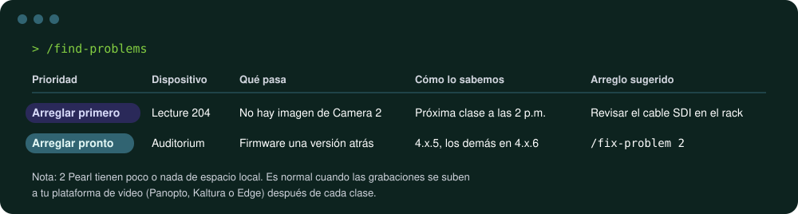
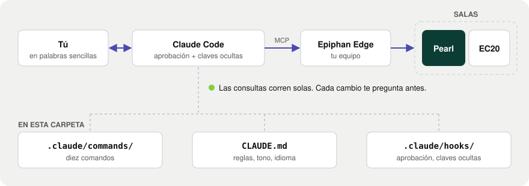

<p align="right"><a href="README.md">English: read this guide in English</a> · Español</p>

<p align="center">
  <picture>
    <source media="(prefers-color-scheme: dark)" srcset="docs/assets/banner-es-dark.svg">
    
  </picture>
</p>

<p align="center">
  <a href="https://github.com/ScientiaCapital/epiphan-edge-claude-kit/actions/workflows/check.yml"></a>
  <a href="https://github.com/ScientiaCapital/epiphan-edge-claude-kit/releases"></a>
  <a href="https://www.epiphan.com/edge/"></a>
  <a href="https://docs.anthropic.com/en/docs/claude-code/overview"></a>
  <a href="LICENSE"></a>
</p>

<p align="center">
  <a href="#empieza-aquí-unos-10-minutos-sin-experiencia-previa">Empieza aquí</a> ·
  <a href="#comandos">Comandos</a> ·
  <a href="#modelo-de-seguridad">Seguridad</a> ·
  <a href="README.md">English</a>
</p>

# Epiphan Edge × Claude Code

Habla con tus dispositivos Epiphan en palabras sencillas. Este kit conecta Claude Code con tu cuenta de
Epiphan Edge para que puedas preguntar "¿Qué está fallando?", ver lo que ve la cámara de una sala e iniciar
una grabación, siempre con tu aprobación antes de cambiar algo.

<p align="center">
  
</p>

<p align="center"><sub>Ejemplo de salida. La tuya muestra tus propias salas.</sub></p>

## Lo que obtienes

| | |
|---|---|
| Respuestas en palabras sencillas | Pregunta "¿Qué salas no pueden grabar mañana?" y recibe una respuesta corta, en tus palabras. |
| Revisión de salas antes de clase | Listo, Listo con notas o No listo, con imagen, sonido y horario revisados. |
| Nada cambia sin tu aprobación | Cada grabación, transmisión, reinicio o arreglo te pregunta antes. |
| Las claves quedan ocultas | Las claves de transmisión y las contraseñas se ocultan antes de que Claude las vea. |
| Español o inglés | Claude responde en el idioma en que escribes. |
| Diez comandos, sin código | Cada comando es un archivo en inglés sencillo que puedes leer y copiar. |

---

## Empieza aquí (unos 10 minutos, sin experiencia previa)

### Lo que necesitas

- Una computadora Mac (macOS 13 o más reciente), Windows 10 u 11, o Linux
- Una cuenta de Epiphan Edge con al menos un dispositivo Epiphan vinculado (Pearl-2, Pearl Mini, Pearl Nano,
  Pearl Nexus, Venue o EC20). Las consultas funcionan con cualquier plan de pago de Edge. Los comandos que
  cambian algo (`/record-room`, `/stream-room`, `/fix-problem`) necesitan Epiphan Edge Premium.
- Un plan de Claude Pro, Max, Team o Enterprise. El plan gratuito no incluye Claude Code.

### Paso 1: Abre una terminal

Una terminal es una ventana donde escribes comandos.

- Mac: presiona `⌘ Command` + `Space`, escribe Terminal y presiona `Enter`.
- Windows: haz clic en Inicio, escribe PowerShell y presiona `Enter`.
- Linux: presiona `Ctrl` + `Alt` + `T`.

### Paso 2: Pega una línea

Copia la línea para tu computadora, pégala en la terminal y presiona `Enter`.

Mac o Linux:
```bash
curl -fsSL https://raw.githubusercontent.com/ScientiaCapital/epiphan-edge-claude-kit/main/install.sh | bash
```

Windows (PowerShell):
```powershell
irm https://raw.githubusercontent.com/ScientiaCapital/epiphan-edge-claude-kit/main/install.ps1 | iex
```

Instala o actualiza Claude Code, descarga la última versión de este kit en `~/epiphan-edge-claude-kit` y abre
Claude Code ahí. Te hace una sola pregunta: tu región. Fíjate en la dirección que usas para iniciar sesión en
Epiphan Edge: go.epiphan.cloud es Norteamérica (North America), eu.epiphan.cloud es Europa (Europe) y
au.epiphan.cloud es Australia. ¿No sabes cuál? Elige North America. Puedes leer el script antes:
[install.sh](install.sh) o [install.ps1](install.ps1).

### Paso 3: Responde tres preguntas en Claude Code

1. ¿Es tu primera vez con Claude Code? Se abre un navegador. Inicia sesión en tu cuenta de Claude.
2. "Do you trust the files in this folder?" (¿Confías en los archivos de esta carpeta?). Elige Yes.
3. "New MCP server found in this project: epiphan" (se encontró un servidor MCP nuevo). Es la conexión con
   Epiphan Edge. Presiona la flecha hacia arriba para resaltar "Use this MCP server" y luego `Enter`. (El
   resaltado empieza en "Continue without using this MCP server", así que si presionas `Enter` de inmediato,
   dices que no).

### Paso 4: Inicia sesión en Epiphan

Escribe `/connect-epiphan` y presiona `Enter`. La primera vez te pide iniciar sesión:

1. Escribe `/mcp` y presiona `Enter`.
2. Con las flechas, elige `epiphan`, presiona `Enter` y luego elige Authenticate (o Re-authenticate).
3. Se abre un navegador. Inicia sesión con tu cuenta de Epiphan Edge. Si te pide un equipo (team), elige el
   que tiene tus salas. (Un equipo es el conjunto de dispositivos que ves en Epiphan Edge. La mayoría de las
   escuelas tiene uno).
4. De vuelta en la terminal, presiona `Esc` y escribe `/connect-epiphan` otra vez.

Cuando te diga que ya estás conectado, escribe `/device-overview`.

### La próxima vez

Abre una terminal y escribe:
```bash
cd ~/epiphan-edge-claude-kit
claude
```
Luego escribe `/check-room` y el nombre de la sala.

Para actualizar el kit, vuelve a pegar la línea del Paso 2. Conserva tus archivos y vuelve a preguntar tu región.

### Ejecútalo desde un script

```bash
cd ~/epiphan-edge-claude-kit
claude -p "/find-problems"
claude -p "¿Qué salas no pueden grabar mañana en la mañana?"
```
Primero inicia sesión una vez (Pasos 3 y 4). Todo lo que cambia un dispositivo necesita que estés en el
teclado, así que un script no puede hacer cambios. Usa la salida predeterminada o `--output-format json`:
`stream-json --verbose` también imprime los datos del dispositivo sin ocultar.

### Si algo no funciona

| Ves esto | Haz esto |
|---|---|
| `command not found: claude` o `'claude' is not recognized` | Cierra la terminal, abre una nueva y vuelve a pegar la línea del Paso 2. |
| `'irm' is not recognized` | Estás en el Símbolo del sistema. Abre PowerShell (Paso 1). |
| `/connect-epiphan` dice que no hay servidor de Epiphan | Escribe `/mcp`, elige `epiphan`, elige Enable, presiona `Esc` y luego `/connect-epiphan` otra vez. |
| `FORBIDDEN`, "not signed in", o ayer funcionaba | Tu sesión de Epiphan no existe o expiró. Escribe `/mcp`, elige `epiphan` y luego Authenticate o Re-authenticate. Si no aparece ninguna, escribe `/exit`, ejecuta `claude mcp login epiphan` y luego `claude`. |
| `FORBIDDEN` otra vez, poco después de iniciar sesión | Otra persona inició sesión en el mismo equipo, y un equipo permite una sola sesión a la vez. Usa Re-authenticate y pónganse de acuerdo sobre quién lo usa, o pide a tu administrador de Epiphan un equipo propio. |
| Falla el inicio de sesión, o "0 devices" | Región o equipo equivocados. Vuelve a pegar la línea del Paso 2 para elegir otra región, o usa Re-authenticate para elegir otro equipo. |
| `/start` o `/triage` no hace nada | Los comandos cambiaron de nombre en la v1.1.0: `/start` es `/connect-epiphan`, `/triage` es `/find-problems` y el `/schedule` del kit es `/upcoming-recordings`. Escribe `/` para verlos todos. |
| Se rechazó un cambio | Los cambios necesitan Epiphan Edge Premium. La cámara EC20 no puede grabar ni transmitir por comando. |
| `BLOCKED: ... bypass mode` | Presiona `Shift+Tab` para salir del modo bypass y vuelve a pedirlo. |
| `BLOCKED: couldn't read this Epiphan tool call` | Vuelve a pedirlo. Si se repite, abre un issue. |
| `READ-ONLY: ...` | Claude Code se inició en modo de solo lectura. Para hacer un cambio, escribe `/exit`, abre una ventana de terminal nueva e inicia `claude` ahí. |
| `[Epiphan kit: ... withheld ...]` | Instala `jq` (consulta Modelo de seguridad), o pregunta por menos dispositivos a la vez. |
| `already exists but isn't this kit` | Otra carpeta tiene el mismo nombre. Cámbiale el nombre y vuelve a pegar la línea del Paso 2. |
| Cualquier otra cosa | Ejecuta `claude doctor`, o [abre un issue](https://github.com/ScientiaCapital/epiphan-edge-claude-kit/issues). |

---

## Comandos

| Comando | Qué hace | ¿Cambia algo? |
|---|---|---|
| `/connect-epiphan` | La primera vez: inicia tu sesión en Epiphan Edge y te da un recorrido rápido | No |
| `/device-overview [group]` | Qué dispositivos están en línea, por grupo y modelo, y su versión de firmware | No |
| `/find-problems [group]` | Qué necesita atención, en palabras sencillas, con lo que hay que arreglar primero | No |
| `/check-room <room> [record\|stream] [channel]` | Si una sala está lista para grabar o transmitir: imagen, sonido, horario | No |
| `/upcoming-recordings [group]` | Qué se va a grabar o transmitir (Panopto, Kaltura, Echo360, Opencast, Edge) y cualquier cosa que pueda impedirlo | No |
| `/view-room <room> [channel]` | Toma la vista previa en vivo y los niveles de audio, y te dice qué hay en pantalla | No |
| `/ask-epiphan-docs <question> [model]` | Responde con las páginas de ayuda oficiales de Epiphan y cita la página | No |
| `/record-room <room> [start\|stop] [channel]` | Revisa la sala → tu aprobación → graba → confirma | Sí (Edge Premium) |
| `/stream-room <room> [destination] [start\|stop]` | Revisa la sala → tu aprobación → transmite → confirma | Sí (Edge Premium) |
| `/fix-problem <# from /find-problems, or room + issue>` | Planea el arreglo, lo aplica con tu aprobación y vuelve a revisar | Sí (Edge Premium) |

O simplemente pregunta: "¿La sala 204 está lista para la clase de las 2 p.m.?"

Eso es todo lo que necesitas en el día a día. El resto de esta página es para quien se encarga de la instalación.

## Cómo encaja todo

<p align="center">
  <picture>
    <source media="(prefers-color-scheme: dark)" srcset="docs/assets/architecture-es-dark.svg">
    
  </picture>
</p>

- `.mcp.json` conecta Claude Code al servidor MCP de Epiphan (`https://go.epiphan.cloud/mcp`). Para Europa o
  Australia, el instalador agrega una configuración privada para esta carpeta (`claude mcp add --scope local`).
  Inicias sesión con tu propia cuenta de Edge y eliges un equipo. Claude solo ve ese equipo.
- Cada comando es un archivo Markdown en inglés sencillo en `.claude/commands/`. `CLAUDE.md` tiene las reglas
  que Claude sigue aquí, incluido su tono tranquilo y que te responda en español o en inglés, según escribas.
- Guías de Epiphan (en inglés): [Connect an AI assistant using MCP](https://kb.epiphan.com/cloud-edge/connect-an-ai-assistant-to-epiphan-cloud-using-mcp),
  [Epiphan MCP capabilities](https://kb.epiphan.com/cloud-edge/epiphan-mcp-capabilities) y
  [Troubleshooting](https://kb.epiphan.com/cloud-edge/verify-and-troubleshoot-the-epiphan-mcp-connection).

## Modelo de seguridad

- El inicio de sesión de Epiphan Edge no es de solo lectura. Puede hacer todo lo que tu cuenta de Edge puede
  hacer en ese equipo. Los límites de abajo vienen de este kit, así que para solo vigilar una flota, usa una
  cuenta de Edge con el rol más bajo.
- Las consultas se ejecutan sin preguntar. Todo cambio (grabación, transmisión, eventos, presets, reinicios,
  firmware) pregunta antes, y un hook agrega una advertencia más visible a los que interrumpen.
- El modo bypass está desactivado en esta carpeta, así que los cambios siguen preguntando con
  `--dangerously-skip-permissions`.
- Las claves de transmisión, las contraseñas y la ruta de cualquier dirección RTMP o SRT se reemplazan con
  `[redacted]` antes de que Claude las vea. Esto necesita `jq` (viene en macOS 15 y más reciente; el
  instalador lo agrega cuando puede, o ejecuta `brew install jq`). Claude Code aun así guarda el original en
  tu historial local (`~/.claude/projects`).
- En Windows, los hooks necesitan Git Bash. Sin él, los cambios siguen preguntando, pero no se oculta nada.
- Claude no reinicia, actualiza ni aplica un preset en un dispositivo que esté grabando, transmitiendo o por
  iniciar un evento programado, y trata los nombres de dispositivos y el texto en pantalla como datos, no
  como instrucciones.

Todos los detalles y límites conocidos: [SECURITY.md](SECURITY.md) (en inglés).

Para bloquear todo cambio, inicia Claude Code en modo de solo lectura:

```bash
EPIPHAN_READ_ONLY=1 claude
```

(En Windows PowerShell: `$env:EPIPHAN_READ_ONLY = "1"; claude`. Queda activo en esa ventana).

Ese interruptor depende de los hooks. Para bloquear cambios sin ellos, pega esto en
`.claude/settings.local.json` (se queda en tu máquina). Las herramientas denegadas desaparecen por completo
para Claude.

<details>
<summary>.claude/settings.local.json</summary>

```json
{
  "permissions": {
    "deny": [
      "mcp__epiphan__batch_recording",
      "mcp__epiphan__start_stream_endpoint",
      "mcp__epiphan__stop_stream_endpoint",
      "mcp__epiphan__create_cms_event",
      "mcp__epiphan__update_cms_event",
      "mcp__epiphan__delete_cms_event",
      "mcp__epiphan__cms_event_action",
      "mcp__epiphan__confirm_cms_event_on_device",
      "mcp__epiphan__create_stream_endpoint",
      "mcp__epiphan__update_stream_endpoint",
      "mcp__epiphan__delete_stream_endpoint",
      "mcp__epiphan__apply_team_preset",
      "mcp__epiphan__switch_device_to_cms",
      "mcp__epiphan__batch_reboot",
      "mcp__epiphan__batch_firmware_update",
      "mcp__claude_ai_Epiphan_MCP__batch_recording",
      "mcp__claude_ai_Epiphan_MCP__start_stream_endpoint",
      "mcp__claude_ai_Epiphan_MCP__stop_stream_endpoint",
      "mcp__claude_ai_Epiphan_MCP__create_cms_event",
      "mcp__claude_ai_Epiphan_MCP__update_cms_event",
      "mcp__claude_ai_Epiphan_MCP__delete_cms_event",
      "mcp__claude_ai_Epiphan_MCP__cms_event_action",
      "mcp__claude_ai_Epiphan_MCP__confirm_cms_event_on_device",
      "mcp__claude_ai_Epiphan_MCP__create_stream_endpoint",
      "mcp__claude_ai_Epiphan_MCP__update_stream_endpoint",
      "mcp__claude_ai_Epiphan_MCP__delete_stream_endpoint",
      "mcp__claude_ai_Epiphan_MCP__apply_team_preset",
      "mcp__claude_ai_Epiphan_MCP__switch_device_to_cms",
      "mcp__claude_ai_Epiphan_MCP__batch_reboot",
      "mcp__claude_ai_Epiphan_MCP__batch_firmware_update",
      "mcp__claude_ai_*Epiphan_Cloud__batch_recording",
      "mcp__claude_ai_*Epiphan_Cloud__start_stream_endpoint",
      "mcp__claude_ai_*Epiphan_Cloud__stop_stream_endpoint",
      "mcp__claude_ai_*Epiphan_Cloud__create_cms_event",
      "mcp__claude_ai_*Epiphan_Cloud__update_cms_event",
      "mcp__claude_ai_*Epiphan_Cloud__delete_cms_event",
      "mcp__claude_ai_*Epiphan_Cloud__cms_event_action",
      "mcp__claude_ai_*Epiphan_Cloud__confirm_cms_event_on_device",
      "mcp__claude_ai_*Epiphan_Cloud__create_stream_endpoint",
      "mcp__claude_ai_*Epiphan_Cloud__update_stream_endpoint",
      "mcp__claude_ai_*Epiphan_Cloud__delete_stream_endpoint",
      "mcp__claude_ai_*Epiphan_Cloud__apply_team_preset",
      "mcp__claude_ai_*Epiphan_Cloud__switch_device_to_cms",
      "mcp__claude_ai_*Epiphan_Cloud__batch_reboot",
      "mcp__claude_ai_*Epiphan_Cloud__batch_firmware_update"
    ]
  }
}
```

</details>

Para un conector con otro nombre, el prefijo es `mcp__claude_ai_` más su nombre con guiones bajos en lugar de
espacios. Escribe `/mcp` para verlo.

## Hazlo tuyo

Cada comando es un archivo Markdown en `.claude/commands/`. Copia `docs/command-template.md`, describe la
revisión en inglés sencillo y enumera las herramientas de lectura que necesita. Consulta
[CONTRIBUTING.md](CONTRIBUTING.md) (en inglés). Problemas de seguridad: consulta [SECURITY.md](SECURITY.md).

## Estado

- La v1.1.4 es la última versión publicada. La integración continua (CI) ejecuta las pruebas de los hooks en
  macOS, Linux y Windows en cada pull request.
- Probado de principio a fin con un equipo real de Epiphan Edge el 8 de octubre de 2026: consultas, claves
  ocultas y un cambio rechazado desde un script.
- Lo que sigue: paquetes iniciales por tipo de cliente (educación superior, eventos en vivo, gobierno).
  Consulta [el plan](docs/next-sprint-proav-tech-brief.md) (en inglés).

## Agradecimientos

Gracias al equipo de ingeniería de Epiphan, que creó el servidor MCP de Epiphan en el que funciona este kit.

## Licencia

[MIT](LICENSE). Este es un kit inicial de la comunidad, no un producto de Epiphan con soporte oficial. Epiphan, Pearl y
Epiphan Edge son marcas comerciales de Epiphan Systems Inc. Claude y Claude Code son marcas comerciales de
Anthropic.
