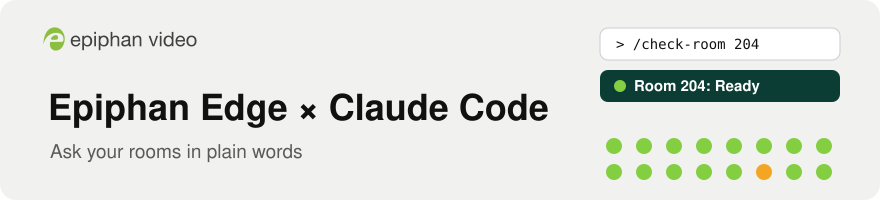
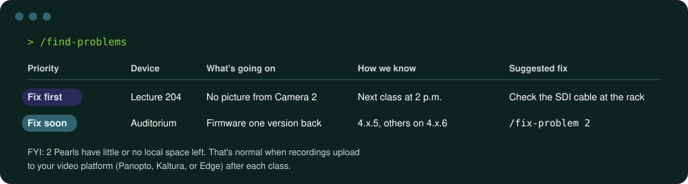
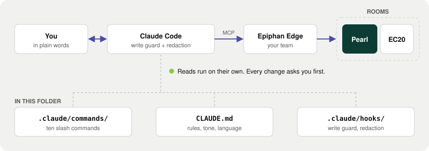

<p align="right">English · <a href="README.es.md">Español: lee esta guía en español</a></p>

<p align="center">
  <picture>
    <source media="(prefers-color-scheme: dark)" srcset="docs/assets/banner-en-dark.svg">
    
  </picture>
</p>

<p align="center">
  <a href="https://github.com/ScientiaCapital/epiphan-edge-claude-kit/actions/workflows/check.yml"></a>
  <a href="https://github.com/ScientiaCapital/epiphan-edge-claude-kit/releases"></a>
  <a href="https://www.epiphan.com/edge/"></a>
  <a href="https://docs.anthropic.com/en/docs/claude-code/overview"></a>
  <a href="LICENSE"></a>
</p>

<p align="center">
  <a href="#start-here-about-10-minutes-no-experience-needed">Start here</a> ·
  <a href="#commands">Commands</a> ·
  <a href="#safety-model">Safety</a> ·
  <a href="README.es.md">Español</a>
</p>

# Epiphan Edge × Claude Code

Talk to your Epiphan devices in plain English or Spanish. This kit connects Claude Code to your Epiphan Edge account, so
you can ask "What's broken?", see what a room's camera sees, and start a recording, with your OK before
anything changes.

<p align="center">
  
</p>

<p align="center"><sub>Example output. Yours shows your own rooms.</sub></p>

## What you get

| | |
|---|---|
| Plain-words answers | Ask "Which rooms can't record tomorrow?" and get a short answer in your own words. |
| Room checks before class | Ready, Ready with notes, or Not ready, with picture, sound, and schedule checked. |
| Nothing changes without your OK | Every recording, stream, reboot, or fix asks you first. |
| Keys stay hidden | Stream keys and passwords are masked before Claude sees them. |
| English or Spanish | Claude answers in the language you write in. |
| Ten commands, no code | Each command is a plain-English file you can read and copy. |

---

## Start here (about 10 minutes, no experience needed)

### What you need

- A Mac (macOS 13 or newer), Windows 10 or 11, or Linux computer
- An Epiphan Edge account with at least one Epiphan device paired to it (Pearl-2, Pearl Mini, Pearl Nano,
  Pearl Nexus, Venue, or EC20). Checking works on any paid Edge plan. The commands that change things
  (`/record-room`, `/stream-room`, `/fix-problem`) need Epiphan Edge Premium.
- A Claude Pro, Max, Team, or Enterprise plan. The free plan doesn't include Claude Code.

### Step 1: Open a terminal

A terminal is a window where you type commands.

- Mac: press `⌘ Command` + `Space`, type Terminal, press `Enter`.
- Windows: click Start, type PowerShell, press `Enter`.
- Linux: press `Ctrl` + `Alt` + `T`.

### Step 2: Paste one line

Copy the line for your computer, paste it into the terminal, and press `Enter`.

Mac or Linux:
```bash
curl -fsSL https://raw.githubusercontent.com/ScientiaCapital/epiphan-edge-claude-kit/main/install.sh | bash
```

Windows (PowerShell):
```powershell
irm https://raw.githubusercontent.com/ScientiaCapital/epiphan-edge-claude-kit/main/install.ps1 | iex
```

It installs or updates Claude Code, downloads the latest release of this kit to `~/epiphan-edge-claude-kit`,
and opens Claude Code there. It asks one question: your region. Check the address you use to sign in to
Epiphan Edge: go.epiphan.cloud is North America, eu.epiphan.cloud is Europe, and au.epiphan.cloud is
Australia. Not sure? Pick North America. You can read the script first: [install.sh](install.sh) or
[install.ps1](install.ps1).

### Step 3: Answer three questions in Claude Code

1. First time using Claude Code? A browser opens. Sign in to your Claude account.
2. "Do you trust the files in this folder?" Choose Yes.
3. "New MCP server found in this project: epiphan". This is the connection to Epiphan Edge. Press the up
   arrow to highlight "Use this MCP server", then press `Enter`. (The highlight starts on "Continue without
   using this MCP server", so pressing `Enter` straight away says no.)

### Step 4: Sign in to Epiphan

Type `/connect-epiphan` and press `Enter`. The first time, it asks you to sign in:

1. Type `/mcp` and press `Enter`.
2. Use the arrow keys to pick `epiphan`, press `Enter`, then choose Authenticate (or Re-authenticate).
3. A browser opens. Sign in with your Epiphan Edge account. If it asks for a team, pick the one with your
   rooms. (A team is the set of devices you see in Epiphan Edge. Most schools have one.)
4. Back in the terminal, press `Esc`, then type `/connect-epiphan` again.

When it says you're connected, type `/device-overview`.

### Next time

Open a terminal and type:
```bash
cd ~/epiphan-edge-claude-kit
claude
```
Then type `/check-room` and the room's name.

To update the kit, paste the Step 2 line again. It keeps your files and asks for your region again.

### Run it from a script

```bash
cd ~/epiphan-edge-claude-kit
claude -p "/find-problems"
claude -p "Which rooms can't record tomorrow morning?"
```
Sign in once first (Steps 3 and 4). Anything that changes a device needs you at the keyboard, so a script
can't make changes. Use the default output or `--output-format json`: `stream-json --verbose` also prints
unredacted device data.

### If you get stuck

| You see | Do this |
|---|---|
| `command not found: claude` or `'claude' is not recognized` | Close the terminal, open a new one, and paste the Step 2 line again. |
| `'irm' is not recognized` | You're in Command Prompt. Open PowerShell (Step 1). |
| `/connect-epiphan` says no Epiphan server | Type `/mcp`, choose `epiphan`, choose Enable, press `Esc`, then `/connect-epiphan` again. |
| `FORBIDDEN`, "not signed in", or it worked yesterday | Your Epiphan sign-in is missing or expired. Type `/mcp`, choose `epiphan`, then Authenticate or Re-authenticate. If neither is there, type `/exit`, run `claude mcp login epiphan`, then `claude`. |
| `FORBIDDEN` again, soon after signing in | Someone else signed in to the same team, and a team allows one sign-in at a time. Re-authenticate, and agree who uses the team, or ask your Epiphan admin for a team of your own. |
| Sign-in fails, or "0 devices" | Wrong region or team. Paste the Step 2 line again to pick another region, or Re-authenticate to pick another team. |
| `/start` or `/triage` does nothing | Commands were renamed in v1.1.0: `/start` is `/connect-epiphan`, `/triage` is `/find-problems`, and the kit's `/schedule` is `/upcoming-recordings`. Type `/` to see them all. |
| A change was refused | Changes need Epiphan Edge Premium. The EC20 camera can't record or stream on command. |
| `BLOCKED: ... bypass mode` | Press `Shift+Tab` to leave bypass mode, then ask again. |
| `BLOCKED: couldn't read this Epiphan tool call` | Ask again. If it keeps happening, open an issue. |
| `READ-ONLY: ...` | Claude Code was started in read-only mode. To make a change, type `/exit`, open a new terminal window, and start `claude` there. |
| `[Epiphan kit: ... withheld ...]` | Install `jq` (see Safety model), or ask about fewer devices at once. |
| `already exists but isn't this kit` | Another folder has the same name. Rename it, then paste the Step 2 line again. |
| Anything else | Run `claude doctor`, or [open an issue](https://github.com/ScientiaCapital/epiphan-edge-claude-kit/issues). |

---

## Commands

| Command | What it does | Changes anything? |
|---|---|---|
| `/connect-epiphan` | First time: signs you in to Epiphan Edge and gives a quick tour | No |
| `/device-overview [group]` | Which devices are online, by group and model, and their firmware version | No |
| `/find-problems [group]` | What needs attention, in plain words, with what to fix first | No |
| `/check-room <room> [record\|stream] [channel]` | Is a room ready to record or stream: picture, sound, schedule | No |
| `/upcoming-recordings [group]` | What's recording or streaming next (Panopto, Kaltura, Echo360, Opencast, Edge), and anything that could stop it | No |
| `/view-room <room> [channel]` | Grabs the live preview and audio levels and tells you what's on screen | No |
| `/ask-epiphan-docs <question> [model]` | Answers from Epiphan's official help pages, with the page cited | No |
| `/record-room <room> [start\|stop] [channel]` | Checks the room → your approval → records → confirms | Yes (Edge Premium) |
| `/stream-room <room> [destination] [start\|stop]` | Checks the room → your approval → streams → confirms | Yes (Edge Premium) |
| `/fix-problem <# from /find-problems, or room + issue>` | Plans the fix, applies it with your approval, and checks again | Yes (Edge Premium) |

Or just ask: "Is Room 204 ready for the 2 p.m. class?"

That's all you need day to day. The rest of this page is for whoever looks after the install.

## How it fits together

<p align="center">
  <picture>
    <source media="(prefers-color-scheme: dark)" srcset="docs/assets/architecture-en-dark.svg">
    
  </picture>
</p>

- `.mcp.json` points Claude Code at Epiphan's MCP server (`https://go.epiphan.cloud/mcp`). For Europe or
  Australia, the installer adds a private override for this folder (`claude mcp add --scope local`). You
  sign in with your own Edge account and pick one team. Claude sees only that team.
- Each command is a plain-English Markdown file in `.claude/commands/`. `CLAUDE.md` holds the rules Claude
  follows here, including its calm tone and answering in English or Spanish to match you.
- Epiphan's guides: [Connect an AI assistant using MCP](https://kb.epiphan.com/cloud-edge/connect-an-ai-assistant-to-epiphan-cloud-using-mcp),
  [Epiphan MCP capabilities](https://kb.epiphan.com/cloud-edge/epiphan-mcp-capabilities), and
  [Troubleshooting](https://kb.epiphan.com/cloud-edge/verify-and-troubleshoot-the-epiphan-mcp-connection).

## Safety model

- The Epiphan Edge sign-in isn't read-only. It can do whatever your Edge account can do in that team. The
  limits below come from this kit, so to only watch a fleet, use an Edge account with the lowest role.
- Reads run without asking. Every write (recording, streaming, events, presets, reboots, firmware) asks
  first, and a hook adds a louder warning to the disruptive ones.
- Bypass mode is turned off in this folder, so writes still ask with `--dangerously-skip-permissions`.
- Stream keys, passwords, and the path of any RTMP or SRT address are replaced with `[redacted]` before
  Claude sees them. This needs `jq` (built into macOS 15 and newer; the installer adds it when it can, or run
  `brew install jq`).
  Claude Code still keeps the original in your local history (`~/.claude/projects`).
- On Windows, the hooks need Git Bash. Without it, writes still ask but nothing is redacted.
- Claude won't reboot, update, or apply a preset to a device that's recording, streaming, or about to start
  a scheduled event, and it treats device names and on-screen text as data, not instructions.

Full detail and known limits: [SECURITY.md](SECURITY.md).

To block every change, start Claude Code in read-only mode:

```bash
EPIPHAN_READ_ONLY=1 claude
```

(Windows PowerShell: `$env:EPIPHAN_READ_ONLY = "1"; claude`. It stays on for that window.)

That switch relies on the hooks. To block writes without them, paste this into `.claude/settings.local.json`
(it stays on your machine). Denied tools disappear from Claude entirely.

<details>
<summary>.claude/settings.local.json</summary>

```json
{
  "permissions": {
    "deny": [
      "mcp__epiphan__batch_recording",
      "mcp__epiphan__start_stream_endpoint",
      "mcp__epiphan__stop_stream_endpoint",
      "mcp__epiphan__create_cms_event",
      "mcp__epiphan__update_cms_event",
      "mcp__epiphan__delete_cms_event",
      "mcp__epiphan__cms_event_action",
      "mcp__epiphan__confirm_cms_event_on_device",
      "mcp__epiphan__create_stream_endpoint",
      "mcp__epiphan__update_stream_endpoint",
      "mcp__epiphan__delete_stream_endpoint",
      "mcp__epiphan__apply_team_preset",
      "mcp__epiphan__switch_device_to_cms",
      "mcp__epiphan__batch_reboot",
      "mcp__epiphan__batch_firmware_update",
      "mcp__claude_ai_Epiphan_MCP__batch_recording",
      "mcp__claude_ai_Epiphan_MCP__start_stream_endpoint",
      "mcp__claude_ai_Epiphan_MCP__stop_stream_endpoint",
      "mcp__claude_ai_Epiphan_MCP__create_cms_event",
      "mcp__claude_ai_Epiphan_MCP__update_cms_event",
      "mcp__claude_ai_Epiphan_MCP__delete_cms_event",
      "mcp__claude_ai_Epiphan_MCP__cms_event_action",
      "mcp__claude_ai_Epiphan_MCP__confirm_cms_event_on_device",
      "mcp__claude_ai_Epiphan_MCP__create_stream_endpoint",
      "mcp__claude_ai_Epiphan_MCP__update_stream_endpoint",
      "mcp__claude_ai_Epiphan_MCP__delete_stream_endpoint",
      "mcp__claude_ai_Epiphan_MCP__apply_team_preset",
      "mcp__claude_ai_Epiphan_MCP__switch_device_to_cms",
      "mcp__claude_ai_Epiphan_MCP__batch_reboot",
      "mcp__claude_ai_Epiphan_MCP__batch_firmware_update",
      "mcp__claude_ai_*Epiphan_Cloud__batch_recording",
      "mcp__claude_ai_*Epiphan_Cloud__start_stream_endpoint",
      "mcp__claude_ai_*Epiphan_Cloud__stop_stream_endpoint",
      "mcp__claude_ai_*Epiphan_Cloud__create_cms_event",
      "mcp__claude_ai_*Epiphan_Cloud__update_cms_event",
      "mcp__claude_ai_*Epiphan_Cloud__delete_cms_event",
      "mcp__claude_ai_*Epiphan_Cloud__cms_event_action",
      "mcp__claude_ai_*Epiphan_Cloud__confirm_cms_event_on_device",
      "mcp__claude_ai_*Epiphan_Cloud__create_stream_endpoint",
      "mcp__claude_ai_*Epiphan_Cloud__update_stream_endpoint",
      "mcp__claude_ai_*Epiphan_Cloud__delete_stream_endpoint",
      "mcp__claude_ai_*Epiphan_Cloud__apply_team_preset",
      "mcp__claude_ai_*Epiphan_Cloud__switch_device_to_cms",
      "mcp__claude_ai_*Epiphan_Cloud__batch_reboot",
      "mcp__claude_ai_*Epiphan_Cloud__batch_firmware_update"
    ]
  }
}
```

</details>

For a connector with another name, the prefix is `mcp__claude_ai_` plus its name with spaces as underscores.
Type `/mcp` to see it.

## Make it yours

Every command is a Markdown file in `.claude/commands/`. Copy `docs/command-template.md`, describe the check
in plain English, and list the read tools it needs. See [CONTRIBUTING.md](CONTRIBUTING.md). Security issues:
see [SECURITY.md](SECURITY.md).

## Status

- v1.1.4 is the latest release. CI runs the hook tests on macOS, Linux, and Windows on every pull request.
- Tested end to end against a live Epiphan Edge team on October 8, 2026: reads, redaction, and a refused
  write from a script.
- Next: starter packs per kind of customer (higher ed, live events, government). See
  [the brief](docs/next-sprint-proav-tech-brief.md).

## Thanks

Thanks to the Epiphan engineering team, who built the Epiphan MCP server this kit runs on.

## License

[MIT](LICENSE). This is a community starter kit, not an official Epiphan product. Epiphan, Pearl, and Epiphan
Edge are trademarks of Epiphan Systems Inc. Claude and Claude Code are trademarks of Anthropic.
